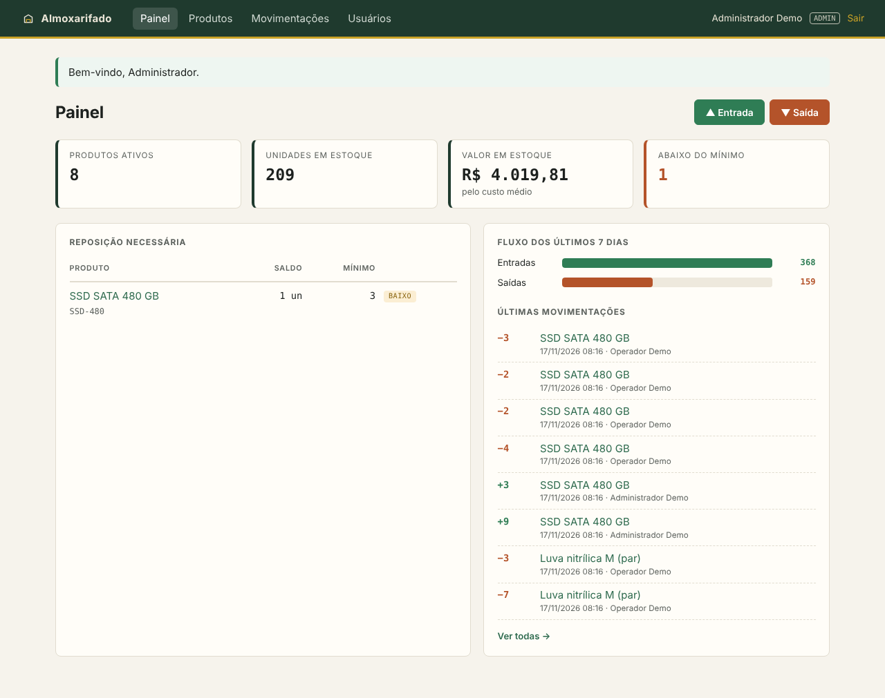
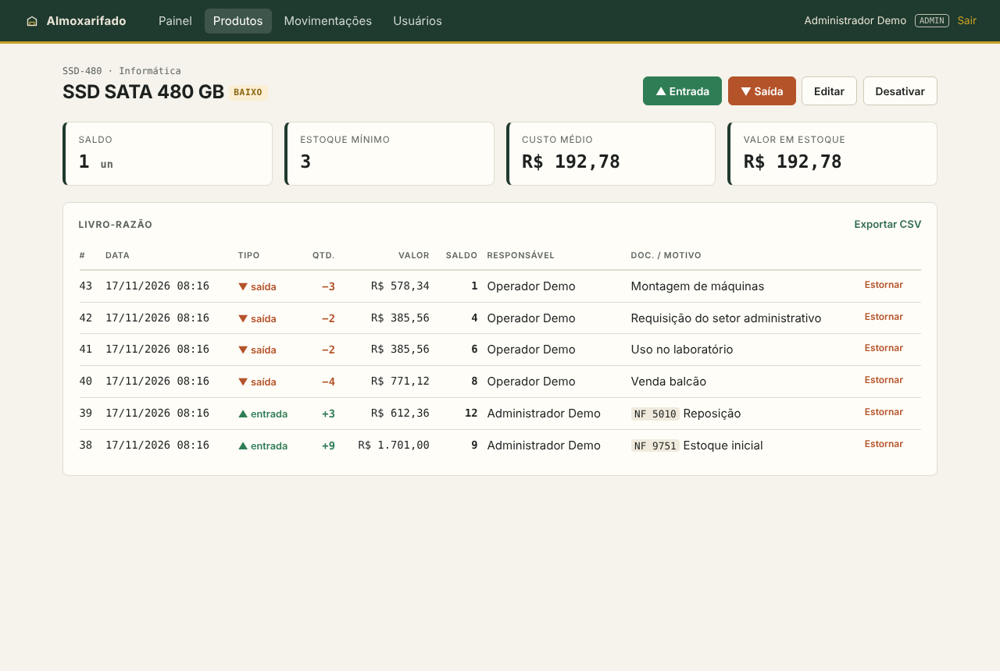
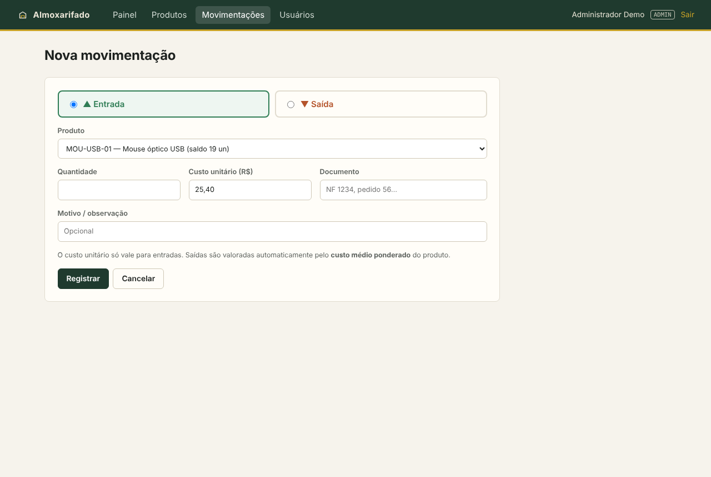

# Almoxarifado — controle de estoque com login

Sistema web de **entrada e saída de produtos** com **autenticação**, feito em Python/Flask.
Cada movimentação é gravada num **livro-razão imutável**; o saldo de um produto é, por definição,
a soma dos seus lançamentos — e o sistema prova isso a qualquer momento.




## Funcionalidades

| Área | O que faz |
|---|---|
| **Login** | Senhas com hash *scrypt*, bloqueio após 5 tentativas, sessão de 2 h, proteção CSRF, papéis `admin` / `operador`, troca de senha |
| **Primeiro acesso** | Banco vazio? A tela de login vira a criação do primeiro administrador — e some depois |
| **Produtos** | Cadastro com SKU, categoria, unidade e estoque mínimo; busca; situação (`ok` / `baixo` / `zerado`); desativação em vez de exclusão |
| **Entradas e saídas** | Lançamento com documento (NF, pedido) e motivo; saída maior que o saldo é recusada |
| **Custo médio ponderado** | Entradas informam o custo; saídas são valoradas automaticamente pela média |
| **Estorno** | Lançamento errado não se apaga: estorna-se, com motivo, e ambos ficam no histórico |
| **Painel** | Indicadores, produtos abaixo do mínimo, fluxo de 7 dias, últimas movimentações |
| **Relatórios** | Filtros por produto, tipo e período; exportação CSV que abre direto no Excel |
| **Auditoria** | `flask verificar-estoque` recalcula todos os saldos a partir do razão |

| Livro-razão de um produto | Nova movimentação |
|---|---|
|  |  |

## Como rodar

Requisito: Python 3.10 ou mais recente.

```bash
git clone https://github.com/Berzeruska/controle-estoque-flask.git
cd controle-estoque-flask

python -m venv .venv
# Linux/macOS:  source .venv/bin/activate
# Windows:      .venv\Scripts\activate

pip install -r requirements.txt
flask --app wsgi seed --sim     # cria o banco com dados de demonstração
flask --app wsgi run            # http://127.0.0.1:5000
```

| Usuário | Senha | Papel |
|---|---|---|
| `admin@demo.com` | `Admin123` | administrador |
| `operador@demo.com` | `Operador123` | operador |

Para começar com o banco vazio, pule o `seed`: o sistema pedirá a criação do administrador.

```bash
python -m pytest -v                     # 26 testes
flask --app wsgi verificar-estoque      # auditoria do razão
```

## Arquitetura

```
app/
├── __init__.py        fábrica da aplicação: configura, registra extensões e rotas
├── extensions.py      db (SQLAlchemy) e csrf, isolados para evitar import circular
├── models.py          Usuario, Produto, Movimentacao
├── services/          REGRAS DE NEGÓCIO — não sabem o que é HTTP
│   ├── usuarios.py      autenticação, bloqueio, criação de usuários
│   └── estoque.py       entrada, saída, estorno, custo médio, auditoria
├── routes/            CAMADA WEB — traduz formulário em chamada de serviço
│   ├── decorators.py    @login_obrigatorio, @admin_obrigatorio
│   └── auth, painel, produtos, movimentacoes, usuarios
├── cli.py             comandos: seed, criar-admin, verificar-estoque
├── templates/         Jinja2
└── static/            CSS próprio, sem framework
config.py              perfis dev / test / prod
tests/                 pytest
```

A separação **rota → serviço → modelo** é o ponto central: a regra "não pode sair mais do que há"
mora em `services/estoque.py` e vale igualmente para o formulário web, para o comando `seed` e para os testes.

## Decisões técnicas (e por quê)

**1. Senha nunca em texto puro.** Guarda-se só o hash (`scrypt`, com sal aleatório). Se o banco vazar,
o atacante tem um resumo irreversível, não a senha — que o usuário provavelmente repete em outros sites.

**2. Mesma mensagem para "e-mail inexistente" e "senha errada".** E mesmo *tempo* de resposta: quando o
e-mail não existe, o sistema confere a senha contra um hash fictício. Do contrário, bastaria cronometrar
as respostas para descobrir quais e-mails estão cadastrados (*enumeração por tempo*).

**3. Bloqueio após 5 erros.** Torna inviável o ataque de força bruta contra uma conta.

**4. CSRF em todo formulário.** Um site malicioso não consegue fazer o navegador do usuário logado
enviar uma "saída de 500 unidades" em nome dele: falta-lhe o token secreto do formulário.
Pela mesma razão, o *logout* é `POST`, não um link.

**5. Cabeçalhos de segurança.** `Content-Security-Policy` só permite recursos do próprio domínio
(um script injetado não roda); `X-Frame-Options: DENY` impede *clickjacking*. Por isso o projeto
não usa CDN nem estilos *inline* — e o campo de custo se esconde na saída apenas com CSS (`:has()`).

**6. Redirecionamento seguro.** O parâmetro `?next=` só aceita caminhos internos; `https://golpe.com` é ignorado.

**7. Dinheiro em centavos inteiros.** `0.1 + 0.2` em ponto flutuante dá `0.30000000000000004`.
Todo valor é um `int` em centavos; a conversão de texto usa `Decimal`. A saída pelo custo médio é
arredondada só com inteiros e, quando sai o estoque inteiro, leva exatamente o valor restante — nenhum centavo fica órfão.

**8. Livro-razão imutável.** Movimentações nunca são editadas ou apagadas; erros se corrigem por
**estorno**. É o princípio da contabilidade de partidas dobradas (Luca Pacioli, 1494) e dos *logs*
de bancos de dados: a história não se reescreve, acrescenta-se. `Produto.estoque` é só um *cache*
da soma, conferível por `verificar-estoque`.

**9. Concorrência otimista.** Dois operadores dão saída no mesmo produto ao mesmo tempo: ambos leem
"saldo 10", ambos gravam "saldo 7" — e uma saída desaparece (*lost update*). A coluna `versao` faz o
SQLAlchemy emitir `UPDATE ... WHERE id = ? AND versao = ?`; quem chega depois não casa nenhuma linha,
recebe `StaleDataError`, e o serviço refaz a operação com o saldo atualizado. Há teste para isso.

**10. Defesa em profundidade.** Além da validação em Python, o banco tem `CHECK (estoque >= 0)` e
`CHECK (quantidade > 0)`: se um dia o código falhar, o banco recusa.

**11. Desativar em vez de excluir.** Um produto com histórico não pode sumir, ou o razão perderia a referência.

## Próximos passos

- Migrações de esquema com **Alembic** (hoje `create_all` basta para SQLite)
- API REST (JSON) reaproveitando a camada de serviços
- PostgreSQL + Docker para produção
- Inventário físico (contagem) com lançamento automático de ajuste
- Leitura de código de barras pela câmera

## Licença

MIT
